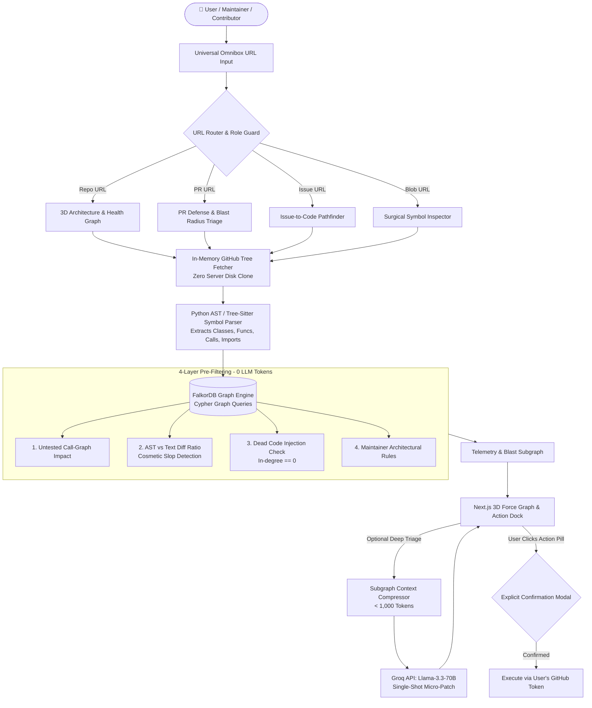

<div align="center">

# 🌐 GitOS
### Graph-Powered Ecosystem Defense & Intelligence Layer for GitHub

[](https://fastapi.tiangolo.com)
[](https://nextjs.org)
[](https://falkordb.com)
[](https://groq.com)
[](LICENSE)

*Protecting open-source maintainers from AI slop, mapping multi-hop blast radius, and equipping contributors with pre-flight impact intelligence—powered by AST symbol graphs and FalkorDB.*

---

</div>

## 📌 Executive Summary

Modern open-source repositories are experiencing a crisis:
1. **Maintainer Burnout:** A tsunami of low-effort, LLM-hallucinated PRs ("AI Slop") that look plausible on the surface but introduce untested regressions, dead code, or cosmetic churn.
2. **Contributor Blindness:** Well-intentioned contributors modify functions without knowing that 15 downstream callers across unrelated modules will silently fail.
3. **Multi-Agent Bloat:** Existing AI review tools spam repositories with endless comment threads, burn through thousands of dollars in LLM tokens, and make unauthorized mutations.

**GitOS changes the paradigm:**
- **Zero-Cost Graph-First Filter:** Performs 90% of structural reasoning deterministically in sub-second time via Python AST and FalkorDB before spending a single LLM token.
- **Zero Disk Clone:** Operates entirely in memory via GitHub's recursive Git Trees API (`/git/trees/{sha}?recursive=1`).
- **Zero Unconsented Spam:** Every action executes strictly through authenticated OAuth tokens with explicit UI confirmation modals.

---

## 🏛️ System Architecture & Workflow



---

## ⚡ The 4 Deterministic Slop & Quality Filters

Before any LLM is called, GitOS executes 4 algorithmic graph checks directly in FalkorDB:

| Filter | Mechanism | Detection Goal |
|---|---|---|
| **1. Untested Call Impact** | Traverses `(:Function)-[:TESTED_BY]->(:Test)` graph for modified AST symbols. | Flags signature breaks or logic changes missing test updates. |
| **2. AST vs. Text Ratio** | Compares AST node changes against raw unified text diff line count. | Flags cosmetic fluff, prompt restatements, and comment spam. |
| **3. Dead Code Injection** | Calculates in-degree of newly defined symbols across the repository call graph. | Flags hallucinated functions with 0 callers (`degree_in == 0`). |
| **4. Maintainer Rule Boundary** | Pattern-matches against custom `(:MaintainerRule)` boundary nodes. | Prevents illegal cross-boundary dependencies (e.g. API calling DB direct). |

---

## 🧠 FalkorDB Graph Model & Cypher Queries (Hackathon Focus)

GitOS utilizes FalkorDB as its core context and reasoning engine. Without FalkorDB, deterministic multi-hop reasoning is impossible.

### 1. Graph Data Model
- **Nodes**:
  - `(:Function {id, name, file_path, line_start, line_end, commit_sha})`
  - `(:Class {id, name, file_path, commit_sha})`
  - `(:Module {path, commit_sha})`
  - `(:Test {id, name, file_path})`
  - `(:MaintainerRule {rule_id, description, forbidden_pattern})`
- **Edges**:
  - `[:CALLS]` — Inter-functional dependency
  - `[:IMPORTS]` — Module-level coupling
  - `[:TESTED_BY]` — Links functions to test symbols
  - `[:DEFINES]` — Module/Class defining a symbol

### 2. Primary Cypher Queries Used by Agents

#### A. Multi-Hop Blast Radius Traversal (Track 1)
Identifies every downstream caller up to $N$ hops that will break if target functions are modified:
```cypher
MATCH (target:Function) WHERE target.id IN $targets
MATCH path = (caller:Function)-[:CALLS*1..$hops]->(target)
RETURN caller.id, target.id, length(path) AS hop_distance
ORDER BY hop_distance ASC
LIMIT 100;
```

#### B. Dead Code / AI-Slop Hallucination Detection (Track 1 & Track 2)
Detects functions introduced by LLMs that have zero incoming call references in the repository topology:
```cypher
MATCH (fn:Function {commit_sha: $commit_sha})
WHERE NOT fn.name STARTS WITH 'test_' AND NOT fn.name STARTS WITH '__'
OPTIONAL MATCH (caller:Function)-[:CALLS]->(fn)
WITH fn, count(caller) AS in_degree
WHERE in_degree = 0
RETURN fn.id, fn.file_path, fn.line_start;
```

#### C. Architectural Boundary Guard (Track 3: Company Brain)
Ensures PRs do not violate organizational or architectural layer boundaries (e.g., UI modules invoking raw DB clients directly):
```cypher
MATCH (src:Function)-[r:CALLS|IMPORTS]->(tgt:Function)
WHERE src.file_path CONTAINS 'frontend' AND (tgt.file_path CONTAINS 'db' OR tgt.file_path CONTAINS 'models')
RETURN src.file_path AS violator, tgt.file_path AS target_forbidden, type(r) AS relation;
```

#### D. Persistent Episodic Memory & State Handoff (Track 2)
Each repository and pull request gets an isolated graph (`gitos_{owner}_{repo}`), enabling agents to persist context, diff snapshots, and maintainer decisions across sessions:
```cypher
MERGE (m:MaintainerMemory {repo: $repo, pr_number: $pr})
SET m.last_risk_score = $score, m.triaged_at = timestamp(), m.agent_status = $status
RETURN m;
```

---

## 🎭 Dual-Mode Experience

GitOS dynamically switches roles based on GitHub OAuth scopes:

### 🛡️ Maintainer Mode (`admin` / `write` permissions)
- **Triage Command Center:** Instant slop score (0-100), multi-hop blast radius visualization, and breaking caller alerts.
- **Maintainer Rule Engine:** Declare and enforce architectural boundaries in Cypher.
- **One-Click Actions:** Post structured triage reports, label PRs, or request test coverage with explicit user confirmation.

### 🚀 Contributor Mode (`read` permissions / PR Author)
- **Pre-Flight Self-Check:** See what you're about to break before maintainers review your PR.
- **Pathfinder:** Paste an issue link to trace relevant files, symbol call chains, and suggested test scaffolds.
- **Safe Patch Assist:** Generate targeted tests for modified functions using single-shot compressed context.

---

## 📂 Repository Structure

```
git-os/
├── .env.example              # Environment variables template
├── shared_contract.json      # Strict API contract between Backend & Frontend
├── README.md                 # Master project documentation
├── docs/
│   ├── prd.md                # Comprehensive Product Requirements Document
│   └── architecture.md       # High-level architecture & FalkorDB schema
├── graph/
│   ├── __init__.py           # Graph package initialization
│   └── client.py             # Production FalkorDB connector & Cypher queries
├── backend/
│   ├── __init__.py           # Backend package initialization
│   ├── requirements.txt      # Python dependencies
│   └── main.py               # FastAPI server, Omnibox router, and filters
└── frontend/
    ├── package.json          # Next.js dependencies
    ├── tsconfig.json         # TypeScript configuration
    └── app/
        ├── layout.tsx        # Root layout with dark mission-control styling
        ├── globals.css       # Core styling & glassmorphism tokens
        └── page.tsx          # 3D Force Graph canvas & telemetry dock
```

---

## 🚀 Quickstart Guide

### Prerequisites
- Python 3.11+
- Node.js 18+
- Docker (for FalkorDB)
- GitHub Personal Access Token or OAuth App credentials
- Groq Cloud API Key

### 1. Launch FalkorDB Graph Database
```bash
# Run FalkorDB container locally
docker run -p 6379:6379 -it --rm falkordb/falkordb:latest
```

### 2. Configure Environment
```bash
cp .env.example .env
# Edit .env with your GITHUB_TOKEN and GROQ_API_KEY
```

### 3. Start Backend (FastAPI)
```bash
cd backend
python -m venv venv
# Windows:
.\venv\Scripts\activate
# Linux/macOS:
source venv/bin/activate

pip install -r requirements.txt
uvicorn main:app --reload --port 8000
```
*API docs available at: `http://localhost:8000/docs`*

### 4. Start Frontend (Next.js)
```bash
cd frontend
npm install
npm run dev
```
*Open application at: `http://localhost:3000`*

---

## 🤝 The GitOS Security & Etiquette Guarantee

1. **No Bot Spam:** GitOS will **never** comment, label, or close a pull request autonomously without an explicit user click and confirmation dialog.
2. **Zero Disk Footprint:** No source code is permanently stored on the host filesystem or cloned to disk.
3. **Encrypted & Ephemeral:** Graph projections in FalkorDB are keyed by `commit_sha` and can be purged at any time.

---

## 📄 License
MIT © 2026 GitOS Authors.
