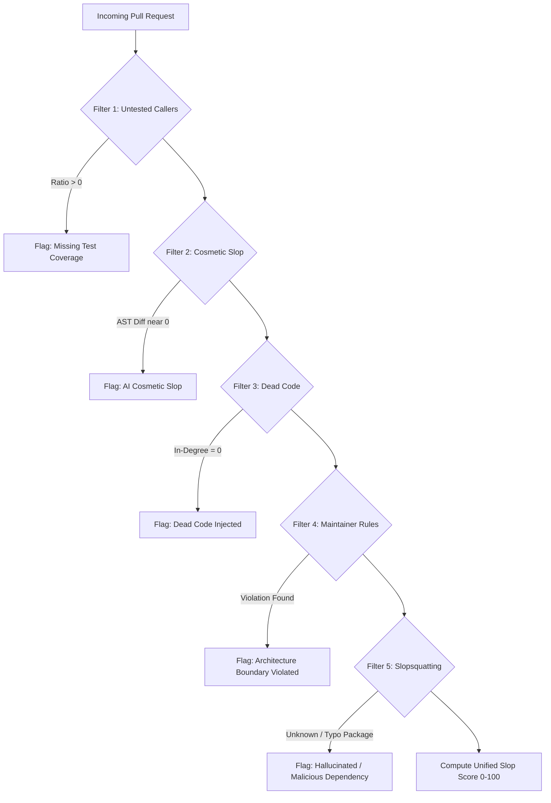
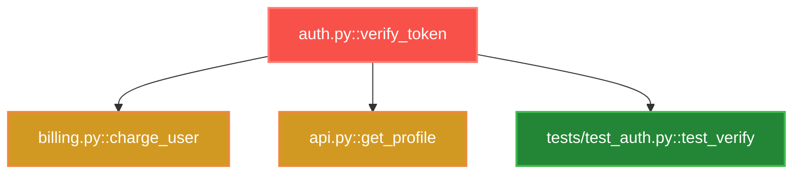

# 📑 GitOS: Product Requirements Document (PRD)

**Document Version:** 1.2.0 (Production-Grade Blueprint)  
**Status:** Approved for Implementation & Release  
**Target Release:** GitOS V1.2 Production Intelligence Engine  
**Author:** GitOS Engineering & Product Management  

---

## 1. Executive Summary & Problem Space

### 1.1 The Open-Source AI Crisis & The Review Bottleneck
The explosion of LLM-assisted coding agents (Cursor, GitHub Copilot, Claude Code) has fundamentally transformed the economics of software development:
- **Asymmetric Cost Imbalance:** Writing 500 lines of syntactically clean code now takes an autonomous agent or junior developer 15 seconds. Verifying its architectural integrity, checking untested callers, validating dependency integrity, and ensuring downstream safety takes an expert human maintainer 45–90 minutes.
- **The "AI Slop" Epidemic:** Repositories are swamped by low-effort AI pull requests: superficial docstring rewrites, dead utility injections, renamed variables, and breaking modifications to core business logic with zero corresponding test updates.
- **Bot Fatigue & Alert Overload:** Existing commercial AI review bots (CodeRabbit, PR-Agent) attempt line-by-line diff commentary. They spam PR threads with 15–20 nitpicks on style, cluttering the discussion, generating out-of-date ghost comments on re-pushes, and failing to detect cross-file breaking changes.
- **Supply Chain Vulnerability (Slopsquatting):** LLMs hallucinate non-existent package names or suggest typo-squatted dependencies, introducing serious supply-chain security risks directly into open-source pull requests.
- **Contributor Blindness:** Well-intentioned contributors are hesitant to contribute because they lack visibility into the codebase's blast radius, frequently submitting PRs that inadvertently break remote downstream callers across unmentioned files.

### 1.2 GitOS Value Proposition
GitOS is the **Zero-Install, Zero-Disk, Zero-Spam Graph Intelligence & Defense Layer** for GitHub. By combining in-memory universal AST extraction, FalkorDB graph indexing, deterministic pre-filtering, and scoped OAuth actions, GitOS delivers:
1. **Zero-Install Instant Onboarding:** Simply paste any GitHub URL into the omnibox—no invasive organization-level GitHub App installation required.
2. **Sub-Second Blast Radius Intelligence:** Interactive visual graph and downstream caller analysis in < 500 ms.
3. **85%+ Deterministic 0-Token Triage:** Filters out cosmetic slop, untested breaking callers, dead code, architectural violations, and hallucinated packages *without burning expensive LLM tokens*.
4. **Zero PR Spam (Sticky Self-Updating Intelligence):** Never spams a PR with multiple comments. Edits a single pinned comment in-place with collapsible telemetry and native inline GitHub Mermaid diagrams.
5. **Zero-Disk In-Memory Execution:** Streams file blobs directly into RAM without cloning repos to disk, satisfying strict enterprise security standards.
6. **IDE-Native (MCP Protocol):** Integrates directly with Cursor, Claude Code, and Antigravity so developers can check blast radius before opening a PR.

---

## 2. Competitive Landscape & Gap Analysis

| Capability / Metric | GitOS | CodeRabbit | Greptile | tng.sh | Socket.dev |
|---|---|---|---|---|---|
| **Primary Focus** | Blast Radius & Slop Defense | Conversational PR Review | Full-Codebase Indexing | Function Blast Radius | Dependency Security |
| **Setup Friction** | **Zero (Paste URL in Omnibox)** | High (GitHub App Org Auth) | High (Full Repo Indexing) | Medium (CLI / GitHub Action) | Medium (GitHub App) |
| **Token Cost per Scan** | **0 Tokens for 85%+ Scans** | 30k–80k tokens/PR | 50k–100k tokens/PR | 0 Tokens (Static analysis) | 0 Tokens (Database lookup) |
| **PR Comment Style** | **1 Sticky Self-Updating Comment** | 10–25 Inline Comments (Spam) | Dense Text Reports | Single Comment | Security Alerts |
| **Visual Graph in PR** | **Native Inline Mermaid Diagrams** | Separate SaaS Web App | None (Text only) | Mermaid Diagram | None |
| **Slopsquatting Detection** | **Built-in (Filter 5 Registry Check)** | No | No | No | Yes (SaaS database) |
| **Server Disk Footprint** | **0 Bytes (100% In-Memory RAM)** | Cloud Container Disk | Cloud Container Disk | Local / Action Disk | Cloud Server |
| **IDE MCP Integration** | **Native MCP Server Endpoints** | IDE Extension | Webhook / API | CLI only | IDE Plugin |

### Key Product Differentiator:
Competitors force teams to choose between noisy, expensive LLM reviewers (CodeRabbit) or static security-only scanners (Socket). **GitOS bridges this divide** by using deterministic code graphs for instant structural safety while reserving compressed LLMs strictly for high-value triage synthesis.

---

## 3. User Personas & Autonomous Intent Architecture

GitOS dynamically adjusts its UI and tooling based on verified GitHub permissions and the input URL. **There are no manual toggles or dropdowns.**

```
                                  ┌───────────────────────────────┐
                                  │   GitHub OAuth Handshake      │
                                  │  (Authenticated or Anonymous) │
                                  └───────────────┬───────────────┘
                                                  │
                                                  ▼
                                  ┌───────────────────────────────┐
                                  │   Universal Omnibox Parser    │
                                  │   (Repo, PR, Issue, or Blob)  │
                                  └───────────────┬───────────────┘
                                                  │
                      ┌───────────────────────────┴───────────────────────────┐
                      ▼                                                       ▼
          [Owner / Write Permission]                              [Read / External Contributor]
          🛡️ Maintainer Cockpit                                  🚀 Contributor Flight Deck
  • Slop Detection Score (0-100)                          • Pre-Flight Blast Radius Check
  • 1-Hop Breaking Downstream Caller Map                  • Untouched Caller & Test Warnings
  • Slopsquatting / Hallucinated Dependency Alert         • Issue-to-Code Pathfinder
  • Custom (:MaintainerRule) Enforcement                  • One-Click Missing Test Stub Generator
  • 1-Click Verified Sticky Comment & Label Triage        • Draft PR / Local Patch Preview
```

### Persona 1: Sarah — The Overwhelmed Maintainer
* **Context:** Maintains a popular open-source project (10,000+ stars) receiving 15–30 PRs weekly.
* **Core Pain:** 60% of incoming PRs are AI-generated slop: cosmetically rewritten comments, hallucinated imports, or refactored functions without test updates. Reviewing them manually leads to burnout.
* **Jobs To Be Done (JTBD):**
  1. Instantly see if a PR touches tests when modifying core public functions.
  2. Detect if new imports are fake or typo-squatted.
  3. Close or label slop PRs in 1 click without typing repetitive explanations.
  4. Post an architectural summary directly to the PR without spamming the thread.

### Persona 2: Alex — The Proactive Contributor
* **Context:** Senior engineer submitting a bugfix to a large, unfamiliar repository.
* **Core Pain:** Terrified of accidentally breaking callers across 20 other files or being rejected by maintainers for missing test coverage.
* **Jobs To Be Done (JTBD):**
  1. Inspect the blast radius of local changes before submitting a PR.
  2. Identify every downstream caller that depends on the modified function.
  3. Automatically discover which existing tests exercise the code path.

---

## 4. The 5 Deterministic Graph Filters (0 LLM Tokens)

GitOS executes 5 deterministic filters directly in memory and via FalkorDB graph traversal before any LLM inference is considered:



### Filter 1: Untested Caller Ratio
* **Logic:** Detects functions modified in the diff that have downstream callers with existing tests where those tests are **not** updated in the PR.
* **Formula:** $\text{Risk} = \frac{|\text{Callers with Untouched Tests}|}{|\text{Total Callers}|} \times 100$.

### Filter 2: AST vs Text Diff Ratio (Cosmetic Slop Detector)
* **Logic:** Measures semantic AST nodes changed versus raw lines modified.
* **Trigger:** If $\Delta_{\text{Lines}} > 30$ and $\Delta_{\text{AST}} < 2$, flag as **Cosmetic Slop** (typical of AI reformatting or re-commenting).

### Filter 3: Dead Code Injection
* **Logic:** Analyzes newly added functions. If their in-degree across the entire repository graph is 0 and they are not exported as public entry points or test cases, flag as dead code.

### Filter 4: Maintainer Architectural Boundary Rules
* **Logic:** Evaluates user-defined rules (e.g. `frontend/*` must never directly import `backend/db/*`, or first-time contributors cannot touch `.github/workflows/*`).

### Filter 5: Slopsquatting & Hallucinated Dependency Sentinel (NEW)
* **Logic:** Extracts all new `import` and `require` statements added in the diff. Cross-checks them against:
  1. The repository's declared package manifest (`requirements.txt`, `package.json`, `pyproject.toml`, `go.mod`).
  2. Public registry availability (PyPI, npm) with caching.
* **Trigger:** If an imported package is not in the project manifest and is either unindexed or newly created with near-zero downloads, immediately alert on potential **AI Hallucination / Slopsquatting Attack**.

---

## 5. Zero-Spam Sticky Comment & Inline Mermaid Architecture

### 5.1 The Sticky Self-Updating Comment Protocol
To eliminate bot fatigue and PR timeline pollution:
1. **Signature Marker:** Every GitOS PR comment begins with a hidden HTML anchor:  
   `<!-- gitos-sticky-intelligence -->`
2. **Search Before Post:** When a triage action is executed:
   - GitOS queries `/repos/{owner}/{repo}/issues/{pr_id}/comments`.
   - If a comment contains `<!-- gitos-sticky-intelligence -->`, GitOS issues a **`PATCH`** request to update the existing comment in-place.
   - If no comment exists, GitOS issues a **`POST`** request to create the initial sticky comment.
3. **Structured Accordions:** The comment uses collapsible `<details>` blocks to provide deep technical evidence without overwhelming the PR discussion.

### 5.2 Native Inline Mermaid Blast Radius
GitOS compiles the impacted subgraph directly into GitHub-native Mermaid syntax within the comment:

```markdown
<!-- gitos-sticky-intelligence -->
## 🛡️ GitOS Blast Radius Intelligence

| Metric | Verdict | Status |
|---|---|---|
| **Slop Risk Score** | **18 / 100** | 🟢 Low Risk |
| **Modified Symbols** | 2 Functions | Verified |
| **Untested Downstream Callers** | 3 Callers | ⚠️ Action Required |
| **Package Integrity** | Clean | ✅ Verified |



<details>
<summary><b>🔍 View Impacted Callers & Recommended Actions</b></summary>

- `billing.py::charge_user` (Untested caller: line 42)
- `api.py::get_profile` (Untested caller: line 88)

**Recommendation:** Add test assertions verifying updated token expiration handling.
</details>

*Automated verification powered by [GitOS](https://github.com/ace-ify/GitOS) • Zero-Disk • Deterministic Graph Engine*
```

---

## 6. Model Context Protocol (MCP) Integration

To bring GitOS intelligence into modern developer IDEs (Cursor, Claude Code, Antigravity):

### Endpoints:
- `POST /mcp/blast-radius`: Accepts local file path + patch string; returns affected downstream symbols and untested callers.
- `POST /mcp/slop-check`: Evaluates patch against the 5 deterministic filters and returns risk score.
- `POST /mcp/pathfinder`: Suggests code files and functions to modify given an issue description.

---

## 7. Non-Functional Requirements & Resilience SLAs

| Metric | Target SLA | Strategy |
|---|---|---|
| **Deterministic Graph Latency** | < 450 ms | In-memory AST + FalkorDB indexing |
| **FalkorDB Cache Replay** | < 30 ms | Subgraph indexed by `commit_sha` |
| **LLM Inference Latency** | < 1.0 s | Groq Cloud Llama-3.3-70B API |
| **Server Memory per Analysis** | < 48 MB | Streamed diff parsing, ephemeral AST |
| **Server Disk Usage** | **0 bytes** | Strict zero-disk policy (No disk cloning) |
| **GitHub API Rate Limit Resilience** | 100% Graceful | Conditional ETag caching (304), rate limit headers |
| **Large Monorepo Handling** | < 2.0 s | Scope tree parsing strictly to modified files & 1-hop callers |

---

## 8. Prioritized Feature Roadmap (RICE Scoring)

| Feature | Reach (1-5) | Impact (1-5) | Confidence (1-5) | Effort (1-5) | RICE Score $\left(\frac{R \times I \times C}{E}\right)$ | Priority |
|---|---|---|---|---|---|---|
| **Sticky Self-Updating PR Comment** | 5 | 5 | 5 | 2 | **62.5** | **P0 (Immediate)** |
| **Inline Mermaid Diagram Generator** | 5 | 5 | 5 | 2 | **62.5** | **P0 (Immediate)** |
| **Filter 5: Slopsquatting Sentinel** | 4 | 5 | 5 | 2 | **50.0** | **P0 (Immediate)** |
| **MCP Server Endpoints for IDEs** | 4 | 4 | 5 | 2 | **40.0** | **P1 (Completed)** |
| **Custom Maintainer Rule Builder UI** | 3 | 4 | 4 | 2 | **24.0** | **P1 (Completed)** |
| **Maintainer Rapid-Triage Deck ("Speed Run" Mode)** | 5 | 5 | 5 | 2 | **62.5** | **P0 (Completed)** |
| **AST Semantic Release Notes & SemVer Bump** | 5 | 4 | 5 | 2 | **50.0** | **P0 (Completed)** |
| **Issue Triage & AST Code Anchor Engine** | 4 | 4 | 5 | 2 | **40.0** | **P1 (Completed)** |
| **GitHub Agentic Workflows (gh-aw) Sync** | 5 | 5 | 5 | 2 | **62.5** | **P0 (Completed)** |

---

## 9. Success Metrics (KPIs)
- **Triage Velocity:** Reduce maintainer PR evaluation time from 45 minutes to < 10 seconds via Rapid-Triage Deck with hotkeys.
- **Zero Bot Spam Complaints:** 0 user reports of PR comment flooding (guaranteed by single sticky comment architecture).
- **Zero-Token Efficiency:** > 85% of incoming pull requests assessed with 0 LLM tokens before calling reasoner.
- **Supply-Chain Interception:** 100% detection of unlisted / hallucinated package imports in tested benchmarks.
- **Release Automation:** 100% automated SemVer bump calculations directly from AST in-degree and signature alterations.

