# 📑 GitOS: Product Requirements Document (PRD)

**Document Version:** 1.0.0  
**Status:** Approved for Implementation  
**Target Release:** V1 Production Engine  
**Author:** GitOS Engineering & Product Architecture  

---

## 1. Executive Summary & Problem Space

### 1.1 The Open-Source AI Crisis
The proliferation of LLM-assisted coding tools has led to a dramatic asymmetric cost imbalance in open-source software maintenance:
- **Generation is Free; Verification is Expensive:** Creating a 400-line pull request takes an LLM 10 seconds. Manually reviewing it, checking for architectural integrity, verifying missing tests, and confirming subtle parameter changes takes a human maintainer 45–90 minutes.
- **The "AI Slop" Epidemic:** Repositories are inundated with syntactically valid but structurally toxic PRs: cosmetic comment rewrites, dead code injection, hallucinated utilities, and modifications to mission-critical functions with zero test updates.
- **Contributor Blindness:** Legitimate contributors who want to fix an issue lack visibility into the repository's blast radius, inadvertently modifying functions that break 10–20 downstream callers across unmentioned files.

### 1.2 GitOS Value Proposition
GitOS is the **first graph-powered ecosystem defense and intelligence layer** for GitHub. By combining in-memory AST extraction, FalkorDB graph caching, and deterministic pre-filtering, GitOS delivers:
- **Instant (sub-second) blast radius awareness.**
- **90% deterministic triage without spending LLM tokens.**
- **Zero-disk server operation (100% in-memory tree processing).**
- **Zero unconsented bot spam via strictly verified user-initiated actions.**

---

## 2. User Personas & Dual-Mode Scope

GitOS dynamically personalizes the UI and functionality based on the user's verified GitHub OAuth scopes and repository permissions:

```
                          ┌──────────────────────────┐
                          │   GitHub OAuth Handshake  │
                          └─────────────┬────────────┘
                                        │
                    ┌───────────────────┴───────────────────┐
                    ▼                                       ▼
        [admin / write scopes]                    [read / author scopes]
       🛡️ Maintainer Mode                       🚀 Contributor Mode
  • Slop Detection & Scoring (0-100)      • Pre-flight blast radius check
  • Multi-hop breaking caller alert       • Missing test coverage alerts
  • Custom (:MaintainerRule) boundaries   • Issue-to-code pathfinder
  • 1-Click triage & label actions        • Auto-generate missing test patch
```

### Persona 1: Sarah — The Overwhelmed Maintainer
* **Profile:** Core maintainer of a widely-used Python web library (8,000+ stars).
* **Pain Points:** Spends 3 hours every day closing duplicate, low-effort PRs; terrified of merging PRs that break downstream consumers; struggles to enforce architectural guidelines across 300+ files.
* **Needs:** Instant signal on whether a PR touched tests, whether changes are cosmetic slop, which public APIs broke, and automated triage generation.

### Persona 2: Alex — The Proactive Contributor
* **Profile:** Full-stack engineer contributing a bug fix to a complex open-source project.
* **Pain Points:** Intimidated by the massive codebase; doesn't know which files to touch; doesn't know what existing tests test the modified function; scared of getting rejected by maintainers.
* **Needs:** Clear guidance on caller blast radius, warnings about untouched test suites, and pathfinding from an issue description to exact functions.

---

## 3. The V1 Golden Path (Step-by-Step Flow)

```mermaid
sequenceDiagram
    autonumber
    actor User as User / Maintainer
    participant UI as Next.js Canvas UI
    participant API as FastAPI Backend
    participant GH as GitHub REST API
    participant Graph as FalkorDB Engine
    participant Groq as Groq Cloud (Llama-3.3-70B)

    User->>UI: Paste GitHub URL (Repo, PR, Issue, or Blob)
    UI->>API: POST /api/analyze { url, auth_token }
    API->>API: parse_github_url() [Regex Omnibox Router]
    
    alt In-Memory Tree Extraction
        API->>GH: GET /repos/{owner}/{repo}/git/trees/{sha}?recursive=1
        GH-->>API: File Tree (JSON, < 7MB, In-Memory)
        API->>GH: Fetch diff / patch for modified files
        GH-->>API: Unified diff in RAM
    end

    API->>API: Python AST parser extracts Classes, Funcs, Calls, Imports
    API->>Graph: Ingest / Update Subgraph & Cache by commit_sha
    
    rect rgb(20, 30, 45)
        Note over API,Graph: 4 Deterministic Filters (0 LLM Tokens)
        API->>Graph: Check 1: Untested Call Impact
        API->>Graph: Check 2: AST vs Text Diff Ratio
        API->>Graph: Check 3: Dead Code Injection
        API->>Graph: Check 4: Maintainer Rule Boundaries
    end

    Graph-->>API: Blast Radius Nodes, Edges & Risk Metrics
    
    opt Complex Triage Request / Auto-Test Generation
        API->>Groq: Single-shot prompt with compressed subgraph (< 1K tokens)
        Groq-->>API: Concise triage verdict & proposed test diff
    end

    API-->>UI: Return Shared Contract Payload (< 400ms)
    UI->>User: Render 3D Force Graph, Telemetry Gauges & Action Dock

    User->>UI: Clicks "Request Test Coverage" Action Pill
    UI->>User: Display Explicit Confirmation Modal
    User->>UI: Confirms Action
    UI->>API: POST /api/execute-action { action_type, payload }
    API->>GH: Execute via User's OAuth Token
    GH-->>UI: 200 OK (Comment posted / PR labeled)
```



---

## 4. Detailed Functional Requirements

### 4.1 Universal Smart Omnibox
- **FR-1.1:** Must support zero-configuration input detection for:
  - Repositories: `https://github.com/:owner/:repo`
  - Pull Requests: `https://github.com/:owner/:repo/pull/:pr_number`
  - Issues: `https://github.com/:owner/:repo/issues/:issue_number`
  - Blobs / Source Files: `https://github.com/:owner/:repo/blob/:ref/:path`
- **FR-1.2:** Must validate URL format client-side and server-side, stripping tracking parameters and normalizing URLs.

### 4.2 In-Memory Git Engine (Zero Disk Footprint)
- **FR-2.1:** The server must **never** run `git clone` to disk.
- **FR-2.2:** File trees must be fetched recursively using `/git/trees/{tree_sha}?recursive=1`.
- **FR-2.3:** Large repos with truncated trees (`truncated: true`) must gracefully fetch sub-trees on-demand or limit analysis to the PR diff scope.
- **FR-2.4:** Only file contents directly involved in the PR diff or 1-hop dependencies must be loaded into memory.

### 4.3 Deterministic Graph Pre-Filters (0 LLM Tokens)
- **FR-3.1 (Untested Callers):** Calculate ratio of modified functions having connected test functions untouched in the PR. If >0, flag alert.
- **FR-3.2 (AST vs Text Diff):** Measure $\Delta_{\text{AST}} / \Delta_{\text{Text}}$. If text changes are high but AST changes are near zero, flag as Cosmetic Slop.
- **FR-3.3 (Dead Code):** Check new functions for in-degree = 0 across the project call graph.
- **FR-3.4 (Maintainer Rules):** Evaluate Cypher patterns representing architectural boundaries.

### 4.4 Single-Shot Compressed LLM Layer
- **FR-4.1:** Context sent to Groq API (Llama-3.3-70B) must strictly not exceed 1,000 tokens.
- **FR-4.2:** Context must contain only the target AST signatures, 1-hop breaking callers, and the unified diff.
- **FR-4.3:** Output must format as structured micro-patches or triage summaries.

### 4.5 Security & Ethical GitHub Actions
- **FR-5.1:** All GitHub write actions (comments, labels, status checks, closing PRs, opening draft PRs) must require:
  1. Authenticated user OAuth token with appropriate scopes.
  2. Explicit user click on a contextual action pill.
  3. Explicit confirmation in a modal showing the exact action payload.
- **FR-5.2:** Zero unprompted bot activity.

---

## 5. Non-Functional Requirements (NFRs)

| Metric | Target SLA | Strategy |
|---|---|---|
| **Deterministic Graph Latency** | < 500 ms | In-memory AST + FalkorDB indexing |
| **FalkorDB Cache Replay** | < 50 ms | Graph snapshot keyed by `commit_sha` |
| **LLM Inference Latency** | < 1.2 s | Groq Cloud Llama-3.3-70B API |
| **Server Memory per Analysis** | < 64 MB | Stream-based diff parsing, ephemeral AST |
| **Server Disk Usage** | 0 bytes | No disk cloning or temp directories |

---

## 6. Release Milestones & Success Metrics

### V1 Milestones
- **M1 (Current):** Foundational directory structure, shared contract, FalkorDB connector stub, FastAPI omnibox router, and 3D Force Graph UI scaffold.
- **M2:** Full in-memory tree parser with Python AST symbol extractor.
- **M3:** 4 Deterministic graph filters implemented in FalkorDB Cypher queries.
- **M4:** Groq context compression integration and explicit OAuth action executor.
- **M5:** Production deployment and public beta.

### Key Performance Indicators (KPIs)
- **Maintainer Triage Time:** Reduced by 75% for incoming PRs.
- **Zero Token Cost for 80% of Scans:** 8 out of 10 clean or obvious slop PRs triaged with 0 LLM tokens.
- **Zero Accidental Write Actions:** 100% adherence to explicit user confirmation policy.
